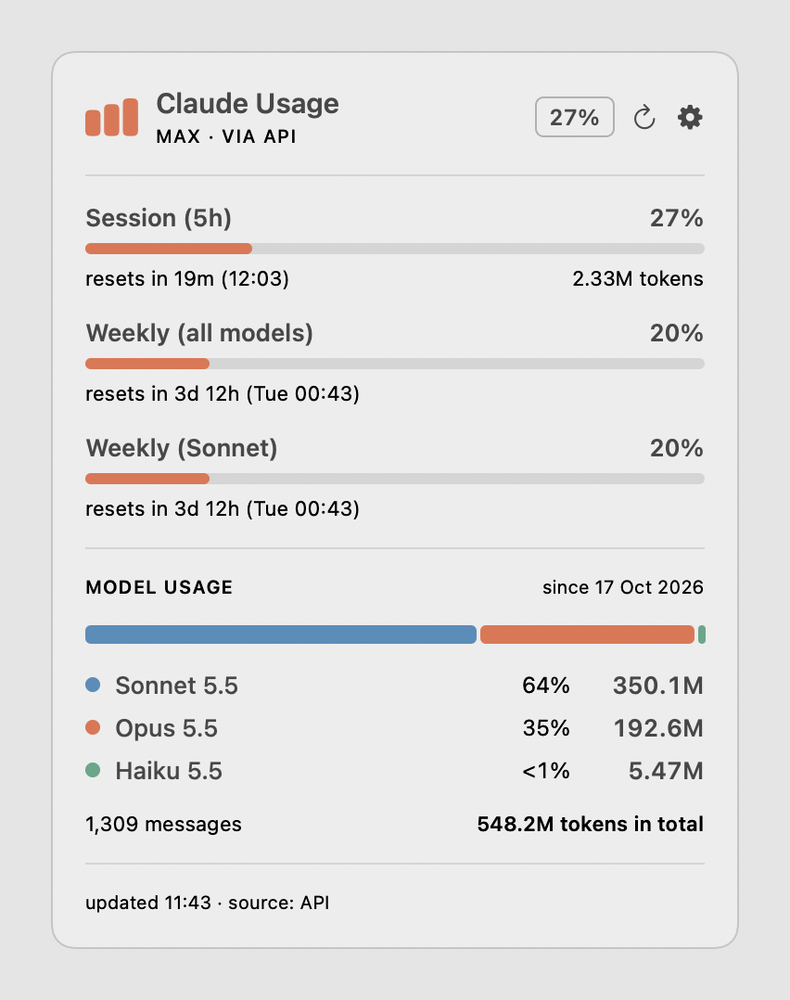
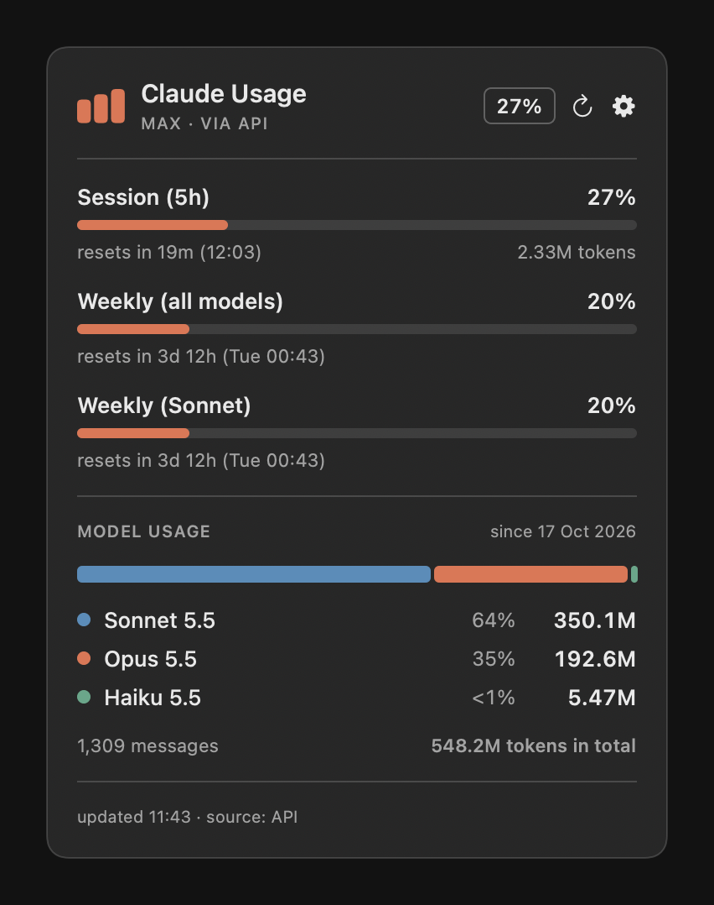

<div align="center">

# Claude Usage for macOS

**Your Claude limits and token usage, one click away in the menu bar.**

A tiny native menu bar app that shows your **5-hour session limit**, your **weekly limits**
and how many tokens you have used **per model since day one**.


&nbsp;&nbsp;

*Screenshots use made-up numbers.*

</div>

---

## Features

- **Icon only in the menu bar.** No text, no clutter. Hover for a one-line summary, click for the panel.
- **Session (5h) and Weekly limits** with progress bars and live "resets in 1h 12m (12:39)" countdowns.
  The bar turns red above 90%.
- **Model usage since your first message.** One stacked bar shows each model's share of everything you
  have used, with a legend of per-model totals. Hover a model to see the input / output / cache breakdown.
- **Two data modes.** Works fully offline from Claude Code's own logs, or (opt-in) shows your *exact*
  limits straight from Claude. See [How it works](#how-it-works).
- **Native and light.** One Swift file, no dependencies, no Dock icon, follows light and dark mode.

## Install

You need a Mac on **macOS 13 (Ventura) or newer** with Apple's command line tools, and you need to be
using [Claude Code](https://claude.com/claude-code) on it.

```bash
xcode-select --install        # skip if you already have Xcode or the command line tools
git clone https://github.com/L33N0tL33/claude-usage-menubar.git
cd claude-usage-menubar
./build.sh
```

The script compiles the app (under a minute), puts **Claude Usage.app** in `~/Applications` and opens it.
Look for the small bar-chart icon in the top right of your menu bar.

> Because you build it yourself, macOS does not quarantine it and there is no "unidentified developer"
> warning. If you copy the finished app to another Mac instead, right-click it and choose **Open**
> the first time.

**Want your own icon?** Put a square, transparent `logo.png` next to `build.sh` before building and it
becomes the menu bar and panel icon. Without one, a plain bar-chart symbol is used.

## Using it

Click the icon to open the panel. Click the gear for settings:

| Menu item | What it does |
|---|---|
| **Exact limits from Claude** | Turns on the exact 5-hour and weekly percentages (off by default, see below). |
| **Set 5-hour limit… / Set weekly limit…** | Your own limits for the offline mode, for example `3m` or `800k`. |
| **Start at login** | Launches the app when you sign in. |
| **Quit** | Closes the app. |

The refresh button (circular arrow) re-reads everything immediately. Otherwise it refreshes once a minute.

## How it works

### Local mode (the default)

Claude Code writes a log of every session to `~/.claude/projects/**/*.jsonl`, including the token counts
of each reply. The app reads those files **on your Mac only** and nothing leaves your machine.

- Resumed sessions copy earlier messages, so every message is counted **once** (matched by message id and
  request id).
- **Counted tokens = input + output + cache writes.** Cache reads are shown in the model totals but not
  counted toward a limit.
- **5-hour window:** starts on the hour of your first message after the previous window ended and lasts
  five hours.
- **Weekly:** a rolling window over the last seven days.
- Percentages only appear if you set your own limits in the gear menu, because the real limit sizes
  are not stored on your computer. Without limits you see token counts.
- It only knows about Claude Code usage **on this Mac**.

### Exact limits (opt-in)

Turn on **Exact limits from Claude** in the gear menu and the panel shows the same percentages and reset
times Claude itself uses, for your whole account (including claude.ai), plus your plan name.

To do that the app:

1. reads the sign-in token Claude Code already keeps in your login Keychain (item
   `Claude Code-credentials`), and macOS asks you to allow it,
2. asks Anthropic's usage endpoint `https://api.anthropic.com/api/oauth/usage` for your current usage
   (at most once every two minutes),
3. shows the result, and falls back to local mode if anything goes wrong.

The code for this is the single function `fetchApi()` in [`main.swift`](main.swift), about 40 lines.
Please read it before you turn the feature on.

## Privacy and security

- **Off by default.** Until you switch on exact limits the app makes **no network requests** and never
  touches your Keychain.
- The token is held in memory just long enough to make one request. It is **never written to disk, never
  logged, and never sent anywhere except Anthropic's API.**
- The app **never refreshes or modifies** the token, so it cannot sign Claude Code out. If the token has
  expired, the panel says so and falls back to local numbers. Use Claude Code once to renew it.
- There is no analytics, no telemetry and no account.

## Good to know

- **This is unofficial.** It is not made, endorsed or supported by Anthropic.
- The usage endpoint is **undocumented** and could change or disappear at any time. If it does, exact
  mode will stop working and the app falls back to local mode. Use it at your own risk.
- Plans and limits change. The panel shows whatever rows the service returns, for example a separate
  weekly row for a single model.

## Troubleshooting

| Problem | Fix |
|---|---|
| macOS asks to use "Claude Code-credentials" | That is exact mode asking permission. Choose **Always Allow**, or turn the feature off in the gear menu. |
| Only token counts, no percentages | Turn on **Exact limits from Claude**, or set your own limits in the gear menu. |
| Orange note: "login token expired" | Open Claude Code once so it renews its sign-in, then press refresh. |
| "no Claude login found" | Sign in with `claude` first. Exact mode needs Claude Code's login. |
| The icon is missing | A crowded menu bar can hide it. Hold ⌘ and drag icons to make room. |
| Numbers look low | Local mode only sees logs on this Mac. Exact mode covers your whole account. |

## Development

```
main.swift     the whole app (scanner, usage service client, SwiftUI panel, menu bar item)
build.sh       compiles into "Claude Usage.app" (OUT=/folder ./build.sh builds elsewhere, no launch)
Info.plist     bundle info (LSUIElement, so there is no Dock icon)
docs/          README screenshots
```

Diagnostics built into the binary:

```bash
APP="$HOME/Applications/Claude Usage.app/Contents/MacOS/ClaudeUsage"
"$APP" --dump                                   # print the local numbers and exit
"$APP" --selftest out.png                       # render the panel to a PNG and exit
"$APP" --selftest out.png --demo --dark         # the same with made-up numbers, in dark mode
```

That is how the screenshots above were made.

## Uninstall

Choose **Quit** in the gear menu, then:

```bash
rm -rf "$HOME/Applications/Claude Usage.app"
defaults delete com.l33n0tl33.claude-usage      # forget your saved settings
```

If you used **Start at login**, turn it off first in the gear menu, or remove it in
System Settings, General, Login Items.

## Credits and licence

Layout inspired by the Claude usage widget in the [Omarchy](https://omarchy.org) bar.

Released under the [MIT License](LICENSE).

*Claude is a trademark of Anthropic, PBC. This project is an independent tool and is not affiliated with
Anthropic.*
